 

  <b>I solve one problem repeatedly: making AI actually useful</b> — through better prompting, smarter tools, and interfaces that don't get in the way.

 

  BS Artificial Intelligence — Air University, Islamabad 
  Currently building <b>Vocvia</b> — a field-wise vocabulary library so beginners can prompt AI effectively

  

 

  <a href="https://github.com/realhassanabbasi/promptsmith"><b>PromptSmith</b></a> &nbsp;·&nbsp; <a href="https://realhassanabbasi.github.io/promptsmith/">try it live in your browser →</a> 
  A CLI that scores any prompt 0–100, explains what's weak, and rewrites it into an engineered prompt. Intent classifier written <b>from scratch</b> (no ML libraries) — 94 training prompts, 8 intents, low-confidence fallback. <b>40 tests green</b>, pip-installable, zero dependencies. The engine also runs live on the web, ported line-for-line. 
  <i>My contribution: everything — concept, classifier math, CLI, tests, docs, web port.</i> 
  <code>Python</code> <code>ML from scratch</code> <code>CLI design</code> <code>interactive web</code>

 

  <a href="https://github.com/realhassanabbasi/Data_structures"><b>Data Structures in C++</b></a> 
  Stacks, queues, linked lists, trees, hash maps — implemented from scratch, documented for learners, with <b>code-verified Big-O tables</b> for every operation. <b>137 assertion-based checks, all passing.</b> The suite caught a real const-correctness bug in <code>QueueArray</code> — and I fixed it. 
  <i>My contribution: all implementations + the test suite — 3rd-semester coursework taken beyond the syllabus.</i> 
  <code>C++</code> <code>testing</code> <code>documentation</code>

 

  <b>Vocvia</b> — <i>in active development</i> 
  Field-wise vocabulary library so beginners can prompt AI effectively. The product thesis behind everything above. 
  <i>My contribution: founder — product, code, and brand design.</i>

  

 

  <b>Languages:</b> Python · C++ · TypeScript · JavaScript 
  <b>AI / ML:</b> PyTorch · prompt engineering · NLP · agentic AI workflows 
  <b>Web:</b> React · Next.js · Tailwind CSS · HTML/CSS · Cloudflare 
  <b>Tools:</b> Git · GitHub Actions basics · ffmpeg/media tooling  
  <i>Every technology above is tied to a repository where I've actually used it — no badge without proof.</i> 
  <i>See <a href="https://github.com/realhassanabbasi/promptsmith">PromptSmith</a>, <a href="https://github.com/realhassanabbasi/Data_structures">Data Structures</a>, <a href="https://github.com/realhassanabbasi/cortvex-digital-core">Cortvex Digital</a>, <a href="https://github.com/realhassanabbasi/Cortvex-web-HassanAbbasi">Cortvex Web</a>.</i>

  

 

  <b>Testing</b> — every flagship ships with a passing test suite (137 checks on Data Structures, 40 on PromptSmith) 
  <b>Code quality</b> — <code>-Wall -Wextra</code> clean builds, const-correctness, no warnings tolerated 
  <b>Documentation</b> — full README on every repo: what, why, how to run, what I learned, honest limitations 
  <b>Honesty</b> — adapted work is credited, licenses kept, contributions stated plainly

  

 

  
  
  
  

  

 

  &nbsp;&nbsp;&nbsp;
  &nbsp;&nbsp;&nbsp;
  &nbsp;&nbsp;&nbsp;
  

 

<i>Clean code, smart systems, beautiful interfaces — that's the standard.</i>

